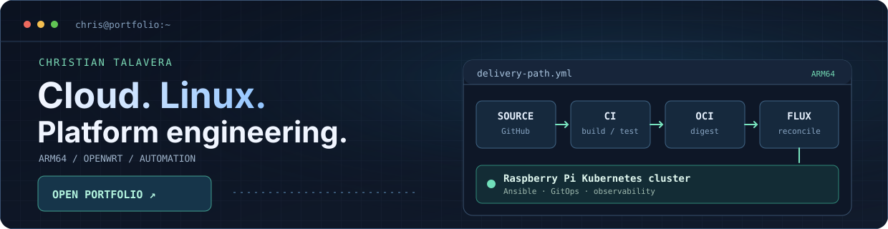

### Hi, I'm Chris.

I work across Linux, cloud infrastructure, networking, and automation. I also spend a lot of time working on ARM64 systems, self-hosted infrastructure, and bringing unsupported network hardware into OpenWrt.

**[Explore the portfolio](https://ctalaveraw.github.io/)** — projects, implementation details, and a browser-based engineering console.

### Selected work

- **[ARM64 platform lab](https://github.com/ctalaveraw/arm-homelab-platform)** — Ansible-managed infrastructure, OCI delivery, Raspberry Pi Kubernetes, Flux, and monitoring. [Implementation and test notes](https://github.com/ctalaveraw/arm-homelab-platform/blob/main/docs/interview/engineering-evidence.md).
- **[MokerLink 2G080GM](https://github.com/openwrt/openwrt/pull/25193)** — merged OpenWrt support for an RTL9303-based 8-port 2.5GbE switch.
- **[GoodTop GT-SWTXG8FM](https://github.com/openwrt/openwrt/pull/25391)** — merged OpenWrt support for an RTL9303-based 8-port SFP+ switch.

The full site and its source live at **[ctalaveraw.github.io](https://ctalaveraw.github.io/)** and **[ctalaveraw/ctalaveraw.github.io](https://github.com/ctalaveraw/ctalaveraw.github.io)**.
